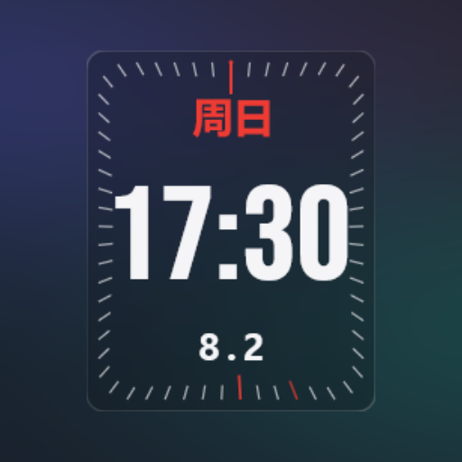
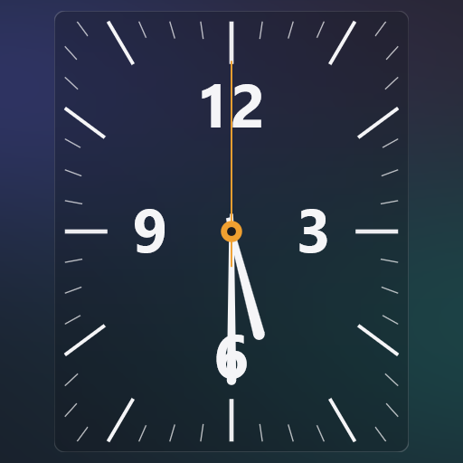

# 刻度时钟 — SnowDesktop 组件

一个 [SnowDesktop](https://snowdesktop.com/) 桌面组件：复刻 [DeskCanvas](https://github.com/Genlue/DeskCanvas) 里那块「刻度时钟」方卡——一圈贴着卡片内缘的刻度、红色的星期、超大的时间和日期；刻度会按时间推进，也可切换为指针表盘。

<p align="center"></p>

<p align="center"></p>

> 非官方组件，与 DeskCanvas 无隶属关系。英文名「Tick Clock」。

## 功能

- **时间驱动刻度**：数字模式下刻度环从 12 点方向起算，按当前时、分、秒高亮对应刻度；秒标记每秒沿环移动，分钟/小时标记随对应时间推进。
- **刻度渐隐**：可开启未高亮刻度随距时间标记的远近逐渐变淡；渐隐范围可调（尾部长度占整圈 25–100%，默认 70%；100% 不渐隐）：当前秒是移动头部，尾部随秒针前进逐渐淡出到最低透明度，头部刻度保持原亮度。渐隐最低透明度可调（0 即完全消失），原有红/白刻度配色和标记逻辑不变；渐隐与刻度高亮互斥。
- **可调刻度**：可设置刻度环圆角半径（0–64 DIP）、普通刻度长度（短边 1–8%）、全盘刻度密度（默认值的 50–200%，默认 70；指针模式按 12 根对齐）、刻度亮度（默认 70）、刻度线粗细（默认值的 30–300%）。
- **时/分/秒标记开关**：时针、分针、秒针的红色刻度高亮可分别关闭；关闭后该刻度恢复普通颜色，并退出渐隐锚点。
- **指针模式**：贴边圆角方形表盘、12/3/6/9 四个数字、时针、分针为根部细、外端粗的圆角锥形指针，秒针为细橙色直线，中心为橙色圆环加暗色内芯；三根指针的长度（短边百分比）与线宽（默认值的 30–300%）分别可调；四个圆角各两根高亮刻度、12/3/6/9 四向刻度的长度也各自可调。隐藏数字时间、星期和日期。
- **设置按模式显示**：数字模式字段只在关闭指针模式时出现，指针模式字段只在打开后出现；共用的密度、亮度、圆角、刻度长度与线宽始终可见。
- **刻度环**：沿卡片内缘等弧长排布，相邻刻度间距一致；每根刻度指向卡片中心。圆角与卡片边框同心（外圈半径 = 卡片圆角 − 内缩量），不是简单的小圆角矩形。
- **星期**：`周日…周六`（中文）或 `SUN…SAT`（英文），固定参考图的红色 `#EE3B33`。
- **时间**：`HH:MM` 或 `H:MM`，内嵌 Bebas Neue；按字形墨迹（不是行框/字宽）适配与居中，数字上下左右都对齐卡片中心。
- **日期**：`11.16` 形式，月日之间用六分之一空格（U+2006）撑开，和参考图的细缝一致。
- **开关**：星期、日期、24 小时制与指针模式各自可关；两个数字标签都关掉时时间占满整卡并垂直居中。
- **自适应**：2×2 默认；数字模式保持文字块比例（高度 ≤ 1.25 × 宽度）并整体居中，指针模式直接铺满组件内容框。
- **外观**：磨砂 / 实色 / 透明三种预设，跟随系统深浅色（前景色取宿主解析后的 contentTheme）。

## 安装

### 从文件安装（推荐）

1. 到本仓库的 [Releases](../../releases) 下载最新的 `tick-clock.snowwidget`。
2. SnowDesktop → **设置 → 组件 → 从文件安装…**，选择该文件。
3. 添加后即可使用；组件不联网、不申请任何权限。

### 作为开发组件

把仓库内容（`widget.json`、`main.lua`、`modules/`、`assets/`、`tests/`）放进：

```
<SnowDesktop 安装目录>\data\widgets\dev\tick-clock\
```

然后在 **设置 → 组件 → 添加组件** 里找到「刻度时钟」。开发目录的改动会即时生效。

开发版清单版本高于已安装版时，可在 **设置 → 组件 → 技术详情 → 安装到“已安装”** 把当前开发快照写入已安装来源，再按需启用或停用开发版。

## 设置项

| 设置 | 默认 | 说明 |
| --- | --- | --- |
| 显示星期 | 开 | 数字模式；关掉后星期行留空 |
| 显示日期 | 开 | 数字模式；关掉后日期行留空 |
| 24 小时制 | 开 | 数字模式；关掉后显示 `1:05` 这样的 12 小时制 |
| 指针模式 | 关 | 隐藏数字时间、星期和日期，显示贴边方形表盘与指针 |
| 刻度渐隐 | 关 | 数字模式；未高亮刻度按距离时间标记由亮到完全消失 |
| 渐隐最低透明度 | 0 | 渐隐范围外的最低不透明度，0 为完全消失（0–100） |
| 渐隐范围 | 70 | 尾部长度占整圈 25–100%；100% 不渐隐 |
| 时针刻度高亮 | 开 | 数字模式；关闭后时针位置不绘制红色标记 |
| 分针刻度高亮 | 开 | 数字模式；关闭后分针位置不绘制红色标记 |
| 秒针刻度高亮 | 开 | 数字模式；关闭后不绘制当前秒的红色刻度点 |
| 刻度密度 | 70 | 默认刻度数的 50–200%；指针模式按 12 根对齐 |
| 刻度亮度 | 70 | 未高亮刻度的基础亮度（5–100） |
| 刻度圆角半径 | 28 | 0–64 DIP，数字与指针模式共用 |
| 刻度长度 | 5 | 短边的 1–8%，数字与指针模式共用 |
| 刻度线粗细 | 100 | 默认线宽的 30–300%，数字与指针模式共用 |
| 角落高亮刻度长度 | 14 | 指针模式；四个圆角各两根，短边的 5–24% |
| 上下左右刻度长度 | 12 | 指针模式；12/3/6/9 四根，短边的 5–24% |
| 时针长度 | 30 | 指针模式；短边的 10–60% |
| 分针长度 | 42 | 指针模式；短边的 10–65% |
| 秒针长度 | 48 | 指针模式；短边的 10–70% |
| 时针粗细 | 100 | 指针模式；默认线宽的 30–300% |
| 分针粗细 | 100 | 指针模式；默认线宽的 30–300% |
| 秒针粗细 | 100 | 指针模式；默认线宽的 30–300% |
| 外观预设 | 磨砂 | 磨砂 / 实色 / 透明 |

## 兼容性

- SnowDesktop 1.0.15.0 及以上（API v2）。
- 需要的组件能力：`draw.immediate`、`view.font`（内嵌字体）、`schedule.basic`、`schedule.visibility`、`time.basic`、`layout.relativeUnits`、`l10n.basic`、`lifecycle.event/model`、`widget.context`。
- 可选能力：`draw.textInkMetrics`（有则按字形墨迹精确居中，没有则退回行框）。
- 无网络域、无权限。

## 实现要点

- **字体**：内嵌 Bebas Neue（SIL OFL 1.1）。宿主的默认字面太宽，方卡上会显得空。字体句柄在入口阶段加载，`setup()` 里再取会触发 `loadPhaseRequired`。
- **时间定位**：在 `render()` 里用 `draw.measureText(text, 100, 0, bold, font).ink` 拿到真实字形盒，按它缩放和居中；`modules/dial.lua` 里保留一份逐字 TTF 度量（advance / xMin / xMax、`inkTop 0.223`、`inkHeight 0.720`）作为取不到 `ink` 时的回退。
- **刻度环**：`modules/dial.lua` 的 `dialTicks()`，移植自参考项目的 `DialTicksControl.cs`——圆角 `卡片圆角 − 内缩`、短边 < 92 px 时不画。数字模式按间距排布并从 12 点对齐，`tickDensity` 直接缩放间距；指针模式按 `60 × 密度 / 100` 把刻度数吸附到 12 的倍数（密度 70 时为 48 根），再按 `count/12`、`count/4` 生成整点、四角与四向层级。`tickRadius/tickLength/tickThickness` 设置作用于普通层级，`cornerTickLength` 控制四个圆角处各两根高亮刻度，`cardinalTickLength` 控制 12/3/6/9 四根刻度。
- **渐隐与锚点**：`main.lua` 与 `modules/dial.lua` 的 `fadeFactor()` 计算刻度到当前秒位置的环形距离；`fadeSpan` 是尾部长度占整圈的比例（25–100%，默认 70%，100% 关闭渐隐）：当前秒位置是头部，alpha 从 1 线性降到下限（默认 0，完全不可见）；秒针前进时旧刻度离开尾部。渐隐与刻度高亮互斥。开启渐隐会自动关闭三个刻度高亮，开启任一高亮会自动关闭渐隐。刻度亮度以 50 为旧基准，高于 50 时各层级向不透明插值，四角/整点/普通刻度的层级不会被压平。
- **设置按模式显示**：数字模式字段使用 `showWhen = { key = "analog", operator = "falsy" }`，指针模式字段使用 `truthy`；渐隐透明度与范围再用 `enabledWhen = { key = "fadeTicks", operator = "truthy" }` 控制可用性。
- **本地化回退**：设置标签经 `text()` 读取 `l10n.tr`；宿主缓存的语言表缺少新键时返回中文兜底，长驻开发实例不会把 `lua_widget.*` 键名直接画到设置页。
- **指针模式**：`clock.handDegrees()` 给出连续角度（时针含分秒偏移、分针含秒偏移）；表盘直接铺满组件内容框，只保留 12/3/6/9 数字与单色时针、分针、秒针，三者长度与线宽分别可调。
- **刷新**：`schedule.every("tick", 1000)`，时钟戳每秒变化才 `widget.invalidate()`；隐藏时暂停，恢复后按当前时间重绘。

## 开发

用 SnowDesktop 自带的 `snowwidget` CLI 校验：

```powershell
snowwidget lint    .
snowwidget test    .      # 17 个用例：格式、刻度几何、指针角度、渐隐、60 刻度表盘、非法输入
snowwidget preview . out.png --columns 2 --rows 2 --locale zh-CN
snowwidget quality .
snowwidget pack    . tick-clock.snowwidget
```

## 设计来源

- 视觉、行高比例（12.5/13/6/38/7/11/12.5%）与刻度参数来自 DeskCanvas 的 `TickClock` 组件（`src/Widgets/ClockCalendar/TickClock`）。
- 圆角处理按参考项目的 `DialTicksControl.CardCornerRadius` 语义：宿主卡片圆角减去内缩量，保证刻度环与边框同心。

## 第三方资源

- `assets/fonts/BebasNeue-Regular.ttf` — Bebas Neue, Copyright (c) Dharma Type，
  SIL Open Font License 1.1，许可证全文见 `assets/fonts/OFL.txt`。

## License

[MIT](LICENSE) © Yskye
